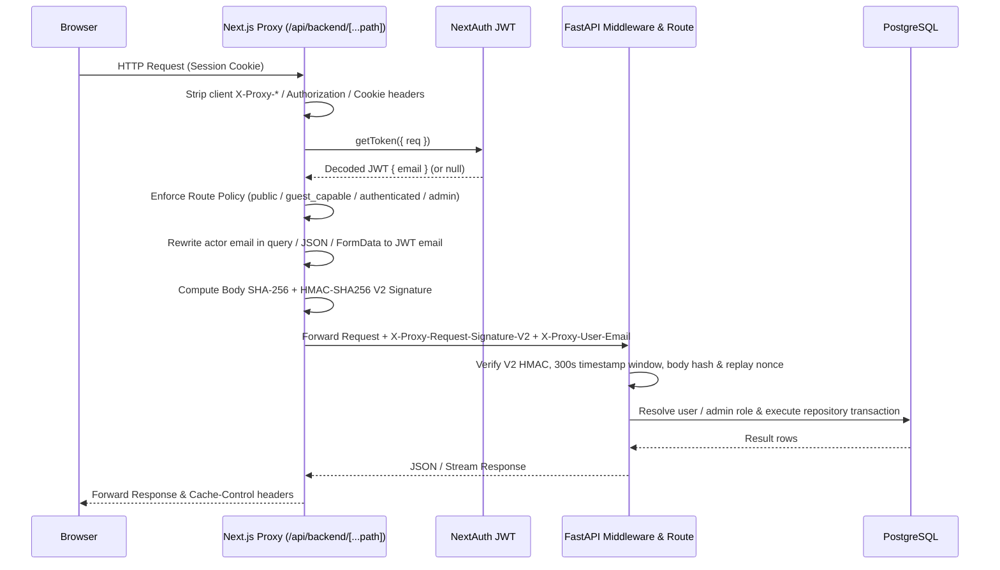
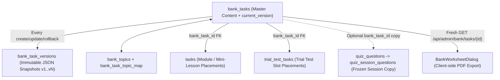
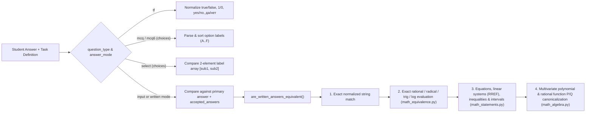

# Data Flow & Core Workflows

This document traces the runtime data flows of QazMath's core subsystems as implemented in the source code.

---

## 1. Request Authentication & Trusted Proxy Signing Flow

All browser API calls in production pass through `/api/backend/[...path]` (`web/app/api/backend/[...path]/route.ts`) before reaching FastAPI (`bot/middleware/trusted_proxy_identity.py`).

### Key Contract Details
- **Canonical Query Preservation:** Commit `c145523` ensures the proxy preserves exact raw query string bytes when signing requests (such as bank search/topic filters containing spaces) so the backend's `request.scope["query_string"]` produces an identical HMAC-SHA256 digest.
- **Replay Protection:** `bot/utils/internal_proxy_auth.py` tracks `(timestamp, nonce)` pairs in `_REPLAY_CACHE` (`_MAX_REPLAY_NONCES = 50000`, 300-second window) per worker process.

---

## 2. Task Bank, Placements & Versioning Flow

`bank_tasks` is the single source of truth for task content across Curriculum Modules, Solo/Co-op Trial Tests, and bank-linked Quiz questions.

1. **Authoring & Optimistic Locking (`bot/repositories/bank/crud.py` & `versions.py`):**
   - Creating a bank task inserts a row into `bank_tasks` with `current_version = 1` and writes an `initial_create` snapshot into `bank_task_versions`.
   - Updating a bank task checks `expected_current_version` against `bank_tasks.current_version`. If another editor saved a newer version concurrently, the backend raises `BankTaskVersionConflictError` (`409 VERSION_CONFLICT`).
   - Before saving, the backend checks `find_similar_tasks` (`SequenceMatcher` similarity threshold `0.80`); unless `confirm_similar=true` is passed, similar existing tasks return `409 SIMILAR_TASKS_FOUND`.
   - Rolling back a task (`POST /api/admin/bank/tasks/{id}/rollback`) restores `text`, `answer`, `question_type`, `answer_mode`, `accepted_answers`, `text_scale`, `options`, `subquestions`, `difficulty`, `image_filename`, `solution_filename`, and `topics` from the target snapshot and records a new `rollback` version event.
2. **Placements (`tasks` & `trial_test_tasks`):**
   - Module lessons (`tasks`) and trial tests (`trial_test_tasks`) store placement metadata (`sort_order`, `mini_lesson_id` or `trial_test_id`, `bank_task_id`) and `LEFT JOIN bank_tasks` on read so edits in the task bank propagate to placements.
   - When a student submits a Solo or Co-op Trial Test, `public_payload.task_review_snapshot` freezes a sanitized copy of each task into `trial_test_results.answers` so historical review screens remain readable even if the trial test slots are later rearranged.

---

## 3. Mathematical Answer Validation & Grading Pipeline

When a student checks a module task (`POST /api/task/check`), submits a trial test (`POST /api/trial-tests/{id}/submit`), finishes a co-op test, or answers a live quiz question, grading is performed by [`bot/utils/validation.py`](../../bot/utils/validation.py):

- **Exact Arithmetic Only:** All numeric and algebraic comparisons use Python's exact `fractions.Fraction` and bounded integer/polynomial arithmetic (`_MAX_EXPRESSION_LENGTH = 512`, `_MAX_AST_NODES = 256`, `_MAX_POLYNOMIAL_DEGREE = 128`, `_MAX_POLYNOMIAL_TERMS = 512`, `_MAX_NUMBER_BITS = 4096`) to prevent floating-point rounding false positives or CPU exhaustion.
- **Unrecognized Answer Logging:** When a student submits an incorrect written answer on a bank-linked task, the answer is normalized and recorded in `bank_task_unrecognized_answers` (surfaced in `/admin/bank` so teachers can promote valid alternative forms to `accepted_answers` with one click).

---

## 4. Live Quiz Lifecycle

1. **Session Creation (`POST /api/quiz-sessions`):**
   - Host selects a quiz (`teacher_paced` or `self_paced`).
   - Backend generates a 6-digit PIN code (`pin_code`) and copies all `quiz_questions` into `quiz_session_questions` so mid-game edits to the template quiz do not alter the running game.
2. **Admission & Joining (`GET /api/quiz-sessions/pin/{pin}` & `POST /api/quiz-sessions/join`):**
   - `QuizEntryLimitsMixin.allow_quiz_entry` enforces per-network 60-second budgets (`1200` requests, `30` distinct PINs, `300` new participants) and the room cap (`500` participants).
   - Joining issues a `participant_token` (stored in browser storage) and optionally generates a per-participant shuffled `question_order` when `shuffle_questions` is enabled.
3. **Gameplay & Scoring (`POST /api/quiz-sessions/{id}/answers`):**
   - Base score is `1000` points (`question_Data.get("points", 1000)`).
   - If `speed_bonus` is enabled on the session, a correct answer awards between `50%` and `100%` of base points based on `time_spent_ms` relative to the question's `time_limit_sec`:
     $$\text{points} = \max\left(0, \text{round}\left(\text{base} \times \left(1 - 0.5 \times \min\left(1, \frac{\text{time\_spent}}{\text{time\_limit}}\right)\right)\right)\right)$$
   - Answers are idempotent per `(participant_id, question_id)`.
4. **State Synchronization:**
   - In `polling` mode, active player tabs request `GET /api/quiz-sessions/{id}/progress` every 4 seconds; `answer` and `next` mutations return the updated progress inline in the same response to avoid extra round trips.

---

## 5. Solo & Cooperative Trial Tests Flow

### 5.1 Solo Trial Tests
- **Catalog & Folders:** Tests are organized in a hierarchical folder tree (`trial_test_folders`). Students see only folders with `test_count > 0` (`GET /api/trial-tests/folders`).
- **Draft Persistence:** While solving, changes are debounced (800 ms) to `PUT /api/trial-tests/{id}/draft`. On SPA navigation (`unmount`) or browser tab close (`pagehide`), `flushDraft` sends a final `keepalive: true` request so the latest answer is not lost.
- **Submission:** `POST /api/trial-tests/{id}/submit` grades all tasks inside a per-`(user_id, test_id)` lock, stores a full `task_snapshot` in `trial_test_results`, clears the user's draft, records first-time task completions (`user_task_completions`), updates the daily streak, and evaluates achievements.

### 5.2 Cooperative (2-Player) Trial Tests
- **Session & Invites:** A host starts a session (`POST /api/trial-tests/{id}/coop/session`) and invites a friend (`POST /api/trial-tests/{id}/coop/invite`). Accepting an invite adds the friend to `trial_test_coop_participants` (max 2 participants: `red` and `blue` slots) and transitions the session to `active`.
- **Shared Answer Sync:** Both players' answers are stored in `trial_test_coop_answers` and synchronized via `PUT /api/trial-tests/coop/session/{id}/answers` (with `keepalive: true` on `pagehide`) and either `/ws/trial-tests/coop/{id}` broadcasts or 2.5-second polling.
- **Completion & Results Gate:** Each participant finishes independently via `POST /api/trial-tests/{id}/coop/finish`. Full review results (`GET /api/trial-tests/coop/session/{id}/results`) return `409` until the requesting participant has `is_finished = 1`.

---

## 6. Mistake Review on Twin Tasks

1. **Mistakes:** `POST /api/task/check` keeps every attempt in `solutions`. A mini-lesson task enters review when the student's earliest attempt was wrong and the task is now completed in `user_progress`; no extra writes happen at check time.
2. **Serving:** `GET /api/mini-lessons/{id}/review` resolves each mistake from `bank_task_twins` (approved only) and `module_review_attempts`: any correct attempt -> `resolved`; otherwise the first approved twin not yet attempted, or the original task once when there are no twins -> `pending`; nothing left -> `weak`. Only the public task payload is returned.
3. **Answering:** `POST /api/mini-lessons/{id}/review/answers` recomputes the item inside a write transaction, accepts the answer only for the task currently served (`409` otherwise), grades it with `is_task_answer_correct`, and appends to `module_review_attempts`. Progress, solved counters, streaks and achievements are untouched.
4. **Twins:** Teachers add twins in the bank (manual, or AI drafts that must be approved). An AI draft is re-solved by a second provider call that never sees its answer; the platform checker compares the two and stores the result on the twin link.
5. **Lesson gate:** `ModuleReviewRepository.get_lesson_gate` orders the module's lessons like the web journey and closes the lesson right after any lesson with pending items in completed mini-lessons, unless the student already has a solution in it. `GET /api/modules/{id}` and `GET /api/lessons/{id}` report the lock; `POST /api/task/check` refuses closed lessons with `423`, checking the cheap "already answered here" case first. Admin accounts skip the gate.
6. **Analytics:** `GET /api/admin/mistake-analytics` replays the same resolution rules over all students, so the outcome counts on `/admin/mistakes` match what students see on the review page.
