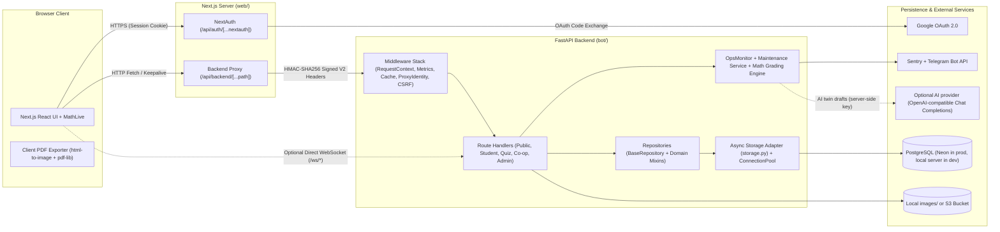

# System Overview

This document describes the actual runtime architecture of QazMath (`CursorMathbot`) as implemented in the repository.

---

## 1. High-Level Topology

QazMath is structured as a two-tier web application with a signed internal proxy boundary between the Next.js frontend and the FastAPI backend:

---

## 2. Deployment & Runtime Modes

The codebase supports two primary operational modes controlled via environment variables (`bot/settings.py` and `web/.env.example`):

### Mode A: Serverless Cloud (Vercel + Neon PostgreSQL + S3) — Primary Production
Documented in [`deploy/NEON_VERCEL.md`](../../deploy/NEON_VERCEL.md) and [`bot/vercel.json`](../../bot/vercel.json):
- **Frontend (`web/`):** Deployed as Vercel project `qazmath` on Node.js `24.x`. Uses `NEXT_PUBLIC_API_URL=/api/backend` and `NEXT_PUBLIC_REALTIME_TRANSPORT=polling`.
- **Backend (`bot/`):** Deployed as Vercel Python function (`main.py`, `maxDuration: 60`, region `cle1`).
- **Database:** Neon PostgreSQL accessed via `DATABASE_URL` (pooled endpoint at runtime) and `DATABASE_MIGRATION_URL` (direct endpoint for migrations and backups).
- **Startup behavior on Vercel (`VERCEL=1`):**
  - `migrate_on_startup` defaults to `False` (`DATABASE_AUTO_MIGRATE=false`) so cold starts do not run schema migrations or full-table seeds.
  - `run_background_tasks` defaults to `False` (`BACKGROUND_TASKS_ENABLED=false`) so in-process infinite `asyncio` loops are not spawned inside serverless invocations.
  - Scheduled maintenance is triggered daily at `22:00 UTC` via Vercel Cron (`GET /api/maintenance` in `bot/vercel.json`) authenticated with `Authorization: Bearer <CRON_SECRET>`.
- **Image Storage:** `IMAGE_STORAGE_BACKEND=s3` backed by a private S3-compatible bucket (`S3_BUCKET`, `S3_ENDPOINT_URL`). The API streams validated image keys through `GET /api/images/{filename}`.
- **AI Twin Drafts (optional):** When `AI_TWIN_BASE_URL`, `AI_TWIN_API_KEY` and `AI_TWIN_MODEL` are set on the API project, `bot/services/ai_twins.py` calls the provider from the API function only; the browser never sees the key. Both the API and the web proxy allow 60 seconds per request.

### Mode B: Containerized / Self-Hosted Process (Docker / Local / VPS)
Configured via [`bot/Dockerfile`](../../bot/Dockerfile), [`web/Dockerfile`](../../web/Dockerfile), and templates in [`deploy/`](../../deploy/):
- **Database:** PostgreSQL via `DATABASE_URL` (required; Neon or a self-hosted server).
- **Startup behavior (`VERCEL != 1`):**
  - Runs the PostgreSQL migrations and bootstrap seeds (`Database.init()`) during the FastAPI lifespan startup hook (`bot/main.py`).
  - Spawns three background `asyncio` loops (`maintenance_task`, `presence_cleanup_task`, `ops_monitor_task`).
- **Realtime Transport:** Supports either WebSockets (`NEXT_PUBLIC_REALTIME_TRANSPORT=websocket` with Nginx/Caddy routing `/ws/*` to `backend:8000`) or HTTP polling (`NEXT_PUBLIC_REALTIME_TRANSPORT=polling`).

---

## 3. Security & Trust Boundaries

### 3.1 Authentication & Trusted Proxy Protocol (`HMAC-SHA256` V2)
1. **Browser Authentication:** Users sign in with Google OAuth via NextAuth (`web/app/api/auth/[...nextauth]/route.ts`). NextAuth stores session state in an encrypted HTTP-only JWT cookie.
2. **Next.js Proxy Boundary (`web/app/api/backend/[...path]/route.ts`):**
   - Strips any incoming client-supplied `X-Proxy-*`, `Authorization`, and `Cookie` headers (`STRIP_REQUEST_HEADERS`).
   - Classifies the target backend path into one of four route policies:
     - `admin`: Requires an authenticated NextAuth session (`/api/admin/*`, `/api/export/admin/*`).
     - `authenticated`: Requires an authenticated NextAuth session (trial test submissions/drafts, co-op sessions, friend requests, reports, user profile updates, quiz hosting/management).
     - `guest_capable`: Allows either an authenticated session or a guest (`X-Quiz-Participant-Token` or public PIN lookup/join on `/api/quiz-sessions/*`, `/api/tasks/{id}/questions/check`).
     - `public`: Allows unauthenticated read access (`/api/health`, `/api/images/*`, `/api/modules/*`, `/api/lessons/*`, `/api/trial-tests`, `/api/quizzes`, `/api/user/public/*`, `/api/friends/invites/{token}`).
   - Canonicalizes actor identity: for non-admin authenticated routes, rewrites `email`, `user_email`, `sender_email`, or `blocker_email` in query parameters, JSON payloads, or `FormData` to the session user's email.
   - Signs the outbound request to FastAPI using `INTERNAL_PROXY_SHARED_SECRET` and attaches:
     - `X-Proxy-Request-Ts` (Unix timestamp, validated within a 300-second window)
     - `X-Proxy-Request-Nonce` (UUIDv4, tracked in a bounded in-memory replay cache)
     - `X-Proxy-Body-Sha256` (SHA-256 digest of the normalized request body)
     - `X-Proxy-User-Email` (when authenticated)
     - `X-Proxy-Request-Signature-V2` (HMAC-SHA256 over method, path, raw query bytes, email, timestamp, nonce, and body SHA-256)
     - `X-Proxy-Signature` (legacy V1 email signature retained for compatibility)
3. **Quiz Entry Network Identity (`web/lib/quiz-entry-identity.ts` & `bot/utils/quiz_entry_auth.py`):**
   - For `GET /api/quiz-sessions/pin/{pin}` and `POST /api/quiz-sessions/join`, the proxy derives an anonymized HMAC network key (`X-Proxy-Quiz-Entry-Key`) and signature (`X-Proxy-Quiz-Entry-Signature`) from the platform's trusted client IP header (`x-vercel-forwarded-for` on Vercel, or `TRUSTED_CLIENT_IP_HEADER` when self-hosted).
   - IPv4 addresses map to `/32`, IPv6 addresses normalize to `/64`, and missing/untrusted headers fall back to a shared `"shared-proxy"` bucket.
4. **FastAPI Verification (`bot/middleware/trusted_proxy_identity.py` & `bot/utils/internal_proxy_auth.py`):**
   - `TrustedProxyIdentityMiddleware` verifies the V2 signature, timestamp window, body SHA-256, and nonce uniqueness before setting `request.state.verified_user_email` and `request.state.proxy_authenticated`.
   - Any request carrying `X-Proxy-*` headers with an invalid signature is rejected with `401 Invalid internal proxy signature`.

### 3.2 Role-Based Access Control (RBAC)
Admin authorization is enforced in `bot/dependencies.py` and `bot/repositories/user_repository.py` using three roles and three capabilities:

| Role | Capabilities | Primary Access Scope |
| :--- | :--- | :--- |
| `super_admin` | `content_manage`, `review_manage`, `super_critical` | Full platform access, including role assignments (`/admin/roles`), permanent deletes, trash emptying, ID counter resets, and `/admin/ops`. |
| `content_editor` | `content_manage` | Curriculum CMS (`/admin/cms`), Task Bank CRUD/import/export (`/admin/bank`), and Trial Tests & Folders (`/admin/trial-tests`). |
| `reviewer` | `review_manage` | Task reports moderation (`/admin/reports`), Bank quality & audit logs (`/admin/bank/quality`, `/admin/bank/audit`), and platform statistics (`/admin/statistics`, `/api/export/admin/stats`). |

> **Bootstrap Note:** If `ADMIN_EMAIL` is set in the backend environment, a user whose email matches `ADMIN_EMAIL` is automatically promoted to `super_admin` (`is_admin = 1`, `admin_role = 'super_admin'`). Legacy `is_admin = 1` rows with `admin_role IS NULL` also resolve to `super_admin` in `dependencies.resolve_admin_role`.

---

## 4. Database & Storage Architecture

- **PostgreSQL Adapter (`bot/storage.py`):**
  - PostgreSQL is the only supported database (SQLite was removed on 2026-11-12); `DATABASE_URL` must be a `postgresql://` URL.
  - Repository code writes PostgreSQL SQL with `?` positional parameters, which `postgres_sql()` turns into `%s`. `PostgresConnection` runs synchronous `psycopg` connections in worker threads, appends `RETURNING id` for `cursor.lastrowid`, and wraps each `INSERT` in a savepoint so a caught duplicate-key error leaves the transaction usable.
  - Timestamps are UTC text; SQL uses `mathbot_datetime('now')` and the other `mathbot_*` functions from `0002_sql_functions.sql`.
- **Connection Pooling (`bot/utils/connection_pool.py` & `bot/database.py`):**
  - Uses `ConnectionPool` with `min_size=0` and `max_size=2`.
  - Write transactions (`BaseRepository._write_transaction()`) serialize concurrent writers with a process-level `asyncio.Lock` and `SELECT pg_advisory_xact_lock(724831921)` (`PostgresConnection.begin_write()`).

---

## 5. Realtime & Background Processing

### 5.1 Dual Realtime Transport (WebSockets vs. HTTP Polling)
The frontend ([`web/lib/websocket-url.ts`](../../web/lib/websocket-url.ts)) selects its transport via `NEXT_PUBLIC_REALTIME_TRANSPORT`:
- **`polling` (Vercel Production):**
  - Live Quiz players poll `GET /api/quiz-sessions/{id}/progress` every 4 seconds while the tab is visible; hosts poll session/leaderboard/stats endpoints.
  - Co-op Trial Test participants poll `GET /api/trial-tests/coop/session/{id}` every 2.5 seconds and sync answers via `PUT /api/trial-tests/coop/session/{id}/answers`.
  - User online presence sends `POST /api/presence/heartbeat` every 25 seconds (70-second DB TTL in `users.last_seen_at`).
- **`websocket` (Local / Self-Hosted VPS):**
  - Clients obtain a short-lived HMAC token from `.../ws-token` and connect to `/ws/quiz/{session_id}`, `/ws/trial-tests/coop/{session_id}`, or `/ws/presence`, with automatic HTTP polling fallback on disconnect.

### 5.2 Observability & Maintenance
- **Request Metrics (`bot/middleware/metrics_middleware.py` & `bot/utils/metrics.py`):** Collects rolling 1-minute, 5-minute, and 60-minute request counts, error rates (`4xx`/`5xx`), and `p50`/`p95`/`p99` latencies keyed by normalized route templates (`GET /api/users/{email}`), bounded to 512 endpoint keys and 2,048 error keys.
- **Operational Health & Incidents (`bot/services/ops_monitor.py` & `bot/repositories/ops_repository.py`):** Samples DB health and in-memory metrics into `ops_health_samples`, opens/resolves deduplicated incidents in `ops_incidents`, and optionally sends rate-limited Telegram alerts (`bot/utils/alerts.py`).
- **Maintenance (`bot/services/maintenance.py` & `bot/routes/maintenance.py`):** Purges soft-deleted tasks (`>10` days for placements, `>30` days for bank tasks), expired quiz entry quota rows, and old ops samples/incidents, and runs `OpsMonitor.run_check_cycle()`.
