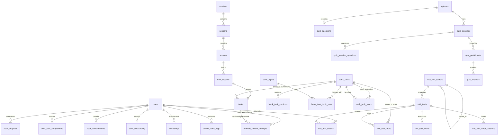

# Database Schema & Migration Reference

This document describes the complete database schema of QazMath (`CursorMathbot`, last reviewed 2026-11-12), verified directly against the PostgreSQL migrations in [`bot/migrations/postgres/`](../../bot/migrations/postgres/) (`0001` through `0009`) and the storage adapter in [`bot/storage.py`](../../bot/storage.py).

---

## 1. Database Engine (`PostgreSQL`)

PostgreSQL is the only supported database: Neon in production, PostgreSQL 17 locally and in CI. SQLite support and its Alembic migrations were removed on 2026-11-12.

| Aspect | Implementation |
|---|---|
| **Driver** | `psycopg[binary]` (`>=3.2,<4`) via `PostgresConnection` in [`bot/storage.py`](../../bot/storage.py), run in worker threads |
| **Configuration** | `DATABASE_URL` (required, `postgresql://...`); `DATABASE_MIGRATION_URL` (optional direct URL for migrations) |
| **Migration Tool** | Checksum-verified SQL runner ([`bot/migrations/postgres_runner.py`](../../bot/migrations/postgres_runner.py), `0001`–`0009`); applied files must never change |
| **Migration Tracking Table** | `mathbot_schema_migrations` (stores `version`, `checksum`, `applied_at`) |
| **Query Placeholders** | Repositories write `?`; `postgres_sql()` rewrites them to `%s` outside quotes/comments. All other SQL is PostgreSQL as written (`ON CONFLICT`, `jsonb_each`, `RETURNING`). |
| **Generated IDs** | `INSERT` into a table with an `id` column gets `RETURNING id` appended unless it has its own `RETURNING`; the value is `cursor.lastrowid` |
| **Write Serialization** | `begin_write()` takes `SELECT pg_advisory_xact_lock(724831921)` + a process `asyncio.Lock` |
| **Timestamps** | UTC text `YYYY-MM-DD HH24:MI:SS`; SQL uses `mathbot_datetime('now')` and the `mathbot_datetime()`, `mathbot_date()`, `mathbot_strftime()`, `mathbot_julianday()` functions from [`0002_sql_functions.sql`](../../bot/migrations/postgres/0002_sql_functions.sql) |

---

## 2. Entity-Relationship Overview

---

## 3. Application Tables by Domain (37 Active Schema Tables)

### 3.1 Users, Roles, Gamification & Onboarding

| Table | Primary Key | Key Columns & Constraints | Description |
|---|---|---|---|
| `users` | `id` (Identity) | `telegram_id BIGINT UNIQUE`, `email TEXT UNIQUE`, `nickname TEXT`, `streak INTEGER DEFAULT 0`, `last_streak_date TEXT`, `is_admin INTEGER DEFAULT 0`, `admin_role TEXT` | Core user identity, daily streak state, and admin RBAC role (`viewer`, `content_editor`, `reviewer`, `super_admin`). Note: `total_points` was dropped in PG `0003`. |
| `user_onboarding` | `user_id` (`FK -> users.id`) | `status TEXT`, `role TEXT`, `grade TEXT`, `goal TEXT`, `completed_at TEXT` | Stores responses from the initial student/teacher onboarding flow (`/api/user/onboarding`). |
| `user_achievements` | `id` (Identity) | `user_id INTEGER FK -> users.id`, `achievement_id TEXT`, `unlocked_at TEXT` | Unlocked achievement badges per user (`UNIQUE(user_id, achievement_id)`). |
| `user_progress` | `id` (Identity) | `user_id INTEGER FK -> users.id ON DELETE CASCADE`, `task_id INTEGER FK -> tasks.id ON DELETE CASCADE`, `status TEXT`, `completed_at TEXT` | Tracks per-user completion status (`solved`) for curriculum tasks (`UNIQUE(user_id, task_id)`). |
| `user_task_completions` | `id` (Identity) | `user_id INTEGER FK -> users.id ON DELETE CASCADE`, `completion_key TEXT`, `bank_task_id INTEGER FK -> bank_tasks.id ON DELETE SET NULL`, `source TEXT`, `completed_at TEXT` | Renamed from `user_task_rewards` in PG `0003` (`points_awarded` and `difficulty` dropped). Deduplicates task completions across curriculum and bank placements (`UNIQUE(user_id, completion_key)`). |
| `user_task_question_progress` | `id` (Identity) | `user_id INTEGER FK -> users.id ON DELETE CASCADE`, `task_id INTEGER FK -> tasks.id ON DELETE CASCADE`, `question_index INTEGER`, `is_completed INTEGER` | Tracks per-subquestion progress on multi-question curriculum tasks (`UNIQUE(user_id, task_id, question_index)`). |
| `solutions` | `id` (Identity) | `user_id INTEGER FK -> users.id ON DELETE CASCADE`, `task_id INTEGER FK -> tasks.id ON DELETE CASCADE`, `answer TEXT`, `is_correct INTEGER` | Historical log of student task answer submissions. The earliest row per `(user_id, task_id)` is the first attempt used by mistake review and analytics (index `idx_solutions_user_task_id`, PG `0008`). |
| `module_review_attempts` | `id` (Identity) | `user_id FK -> users.id ON DELETE CASCADE`, `task_id FK -> tasks.id ON DELETE CASCADE` (the reviewed placement), `bank_task_id FK -> bank_tasks.id ON DELETE CASCADE` (the twin or original served), `answer TEXT`, `is_correct`, `created_at` | Added in PG `0008`. Mistake-review answers, kept apart from `solutions` so review never changes progress, streaks or achievements. |
| `user_progress_summary` | `id` (Identity) | `user_id`, `module_id`, `section_id`, `lesson_id`, `mini_lesson_id`, `completed_tasks`, `total_tasks`, `completion_percent` | **Unused / Legacy**: Created in `0001_initial.sql` with cascading FKs, but no repository currently reads or writes to this table (progress is aggregated on the fly from `user_progress`). |

### 3.2 Centralized Question Bank (`/admin/bank`)

| Table | Primary Key | Key Columns & Constraints | Description |
|---|---|---|---|
| `bank_tasks` | `id` (Identity) | `text TEXT`, `answer TEXT`, `question_type TEXT DEFAULT 'input'`, `options TEXT` (JSON), `subquestions TEXT` (JSON), `difficulty TEXT DEFAULT 'B'`, `image_filename TEXT`, `solution_filename TEXT`, `created_by INTEGER FK -> users.id ON DELETE SET NULL`, `current_version INTEGER DEFAULT 1`, `deleted_at TEXT` | Master repository of reusable math tasks. Soft-deleted tasks have `deleted_at IS NOT NULL`. |
| `bank_topics` | `id` (Identity) | `name TEXT NOT NULL`, `norm_name TEXT UNIQUE NOT NULL`, `created_at TEXT` | Normalized topic taxonomy tags for bank tasks (`GET /api/admin/bank/catalog`). |
| `bank_task_topic_map` | `(bank_task_id, topic_id)` | `bank_task_id FK -> bank_tasks.id ON DELETE CASCADE`, `topic_id FK -> bank_topics.id ON DELETE CASCADE` | Many-to-many join table linking `bank_tasks` to `bank_topics`. |
| `bank_task_versions` | `id` (Identity) | `bank_task_id INTEGER FK -> bank_tasks.id ON DELETE CASCADE`, `version_no INTEGER`, `event_type TEXT`, `snapshot_json TEXT`, `actor_user_id INTEGER FK -> users.id ON DELETE SET NULL`, `reason TEXT`, `source TEXT` | Immutable audit/rollback history (`UNIQUE(bank_task_id, version_no)`) recording every change to a bank task. |
| `bank_task_twins` | `id` (Identity) | `source_bank_task_id FK -> bank_tasks.id ON DELETE CASCADE`, `twin_bank_task_id FK -> bank_tasks.id ON DELETE CASCADE UNIQUE`, `status TEXT` (`draft`/`approved`), `origin TEXT` (`manual`/`ai`), `sort_order`, `created_by FK -> users.id ON DELETE SET NULL`; AI check columns `ai_model`, `ai_check_status` (`match`/`mismatch`/`error`), `ai_check_answer`, `ai_checked_version`, `ai_checked_at` | Added in PG `0008` (AI columns in PG `0009`). Links a number-only twin to exactly one source task. Only `approved` twins are served by mistake review; twin tasks are hidden from the bank library, pickers, catalog counts and quality reports. |

### 3.3 Curriculum Hierarchy (`modules` -> `sections` -> `lessons` -> `mini_lessons` -> `tasks`)

| Table | Primary Key | Key Columns & Constraints | Description |
|---|---|---|---|
| `modules` | `id` (Identity) | `name TEXT`, `description TEXT`, `icon TEXT`, `sort_order INTEGER` | Top-level curriculum modules. |
| `sections` | `id` (Identity) | `module_id INTEGER FK -> modules.id ON DELETE CASCADE`, `name TEXT`, `sort_order INTEGER`, `description TEXT`, `guide_text TEXT` | Sections within a module. |
| `lessons` | `id` (Identity) | `section_id INTEGER FK -> sections.id ON DELETE CASCADE`, `lesson_number INTEGER`, `title TEXT`, `sort_order INTEGER` | Numbered lessons inside a section. |
| `mini_lessons` | `id` (Identity) | `lesson_id INTEGER FK -> lessons.id ON DELETE CASCADE`, `mini_index INTEGER` (`1`–`4`), `title TEXT`, `sort_order INTEGER` | Each lesson contains 4 mini-lessons (`UNIQUE(lesson_id, mini_index)`). |
| `tasks` | `id` (Identity) | `section_id FK -> sections.id`, `mini_lesson_id FK -> mini_lessons.id ON DELETE CASCADE`, `bank_task_id FK -> bank_tasks.id ON DELETE CASCADE`, `text TEXT`, `answer TEXT`, `question_type TEXT`, `options TEXT`, `subquestions TEXT`, `image_filename TEXT`, `solution_filename TEXT`, `difficulty INTEGER`, `sort_order INTEGER`, `deleted_at TEXT` | Curriculum task placements. When `bank_task_id` is set, content is synchronized with the parent `bank_tasks` record. |

### 3.4 Trial Tests (Folders, Templates, Solo & Co-op)

| Table | Primary Key | Key Columns & Constraints | Description |
|---|---|---|---|
| `trial_test_folders` | `id` (Identity) | `name TEXT NOT NULL`, `slug TEXT UNIQUE NOT NULL`, `parent_id INTEGER FK -> trial_test_folders.id ON DELETE RESTRICT`, `category TEXT DEFAULT 'ҰБТ'`, `sort_order INTEGER DEFAULT 0` | Added in PG `0007`. Hierarchical folders organizing trial tests. Deletion is restricted while children or tests exist. |
| `trial_tests` | `id` (Identity) | `title TEXT`, `description TEXT`, `category TEXT DEFAULT 'ҰБТ'`, `folder_id INTEGER FK -> trial_test_folders.id ON DELETE RESTRICT`, `sort_order INTEGER`, `expected_tasks_count INTEGER DEFAULT 40`, `is_published INTEGER DEFAULT 0`, `created_by FK -> users.id ON DELETE SET NULL` | Trial test exam templates (`category` added in PG `0004`; `folder_id` added in PG `0007`). |
| `trial_test_tasks` | `id` (Identity) | `trial_test_id INTEGER FK -> trial_tests.id ON DELETE CASCADE`, `bank_task_id INTEGER FK -> bank_tasks.id ON DELETE CASCADE`, `text TEXT`, `answer TEXT`, `question_type TEXT`, `options TEXT`, `subquestions TEXT`, `difficulty INTEGER`, `expected_tier TEXT`, `sort_order INTEGER` (`0`–`39`), `deleted_at TEXT` | Ordered task slots within a trial test. |
| `trial_test_drafts` | `id` (Identity) | `user_id INTEGER FK -> users.id ON DELETE CASCADE`, `trial_test_id INTEGER FK -> trial_tests.id ON DELETE CASCADE`, `answers TEXT` (JSON), `current_index INTEGER`, `updated_at TEXT` | Server-saved in-progress solo exam drafts (`UNIQUE(user_id, trial_test_id)`). |
| `trial_test_results` | `id` (Identity) | `user_id INTEGER FK -> users.id ON DELETE CASCADE`, `trial_test_id INTEGER FK -> trial_tests.id ON DELETE CASCADE`, `score INTEGER`, `total INTEGER`, `percentage REAL`, `answers TEXT` (JSON), `completed_at TEXT` | Completed solo and co-op trial test attempt scores and answer breakdowns. |
| `trial_test_coop_sessions` | `id` (Identity) | `trial_test_id INTEGER FK -> trial_tests.id ON DELETE CASCADE`, `owner_id INTEGER FK -> users.id ON DELETE CASCADE`, `mode TEXT DEFAULT 'coop'`, `status TEXT DEFAULT 'active'` | Active or finished 2-player co-op trial test sessions. |
| `trial_test_coop_participants` | `id` (Identity) | `session_id INTEGER FK -> trial_test_coop_sessions.id ON DELETE CASCADE`, `user_id INTEGER FK -> users.id ON DELETE CASCADE`, `color TEXT` (`red` or `blue`), `is_finished INTEGER DEFAULT 0` | Participants in a co-op session (`UNIQUE(session_id, user_id)`). |
| `trial_test_coop_answers` | `id` (Identity) | `session_id INTEGER FK -> trial_test_coop_sessions.id ON DELETE CASCADE`, `user_id INTEGER FK -> users.id ON DELETE CASCADE`, `task_id INTEGER`, `answer TEXT` | Live synchronized task answers per participant (`UNIQUE(session_id, user_id, task_id)`). |
| `trial_test_coop_invites` | `id` (Identity) | `session_id FK -> trial_test_coop_sessions.id`, `sender_id FK -> users.id`, `receiver_id FK -> users.id`, `status TEXT DEFAULT 'pending'` | Friend invitations to join a co-op session. |
| `trial_test_coop_results` | `id` (Identity) | `session_id FK -> trial_test_coop_sessions.id`, `user_id FK -> users.id`, `trial_test_result_id FK -> trial_test_results.id` | Links a co-op session to each participant's generated `trial_test_results` row (`UNIQUE(session_id, user_id)`). |

### 3.5 Live Classroom Quizzes (`/quiz`)

| Table | Primary Key | Key Columns & Constraints | Description |
|---|---|---|---|
| `quizzes` | `id` (Identity) | `title TEXT`, `description TEXT`, `created_by INTEGER FK -> users.id`, `is_public INTEGER DEFAULT 0`, `mode TEXT DEFAULT 'teacher_paced'` | Reusable quiz templates. |
| `quiz_questions` | `id` (Identity) | `quiz_id INTEGER FK -> quizzes.id ON DELETE CASCADE`, `text TEXT`, `question_type TEXT`, `options TEXT`, `answer TEXT`, `time_limit INTEGER DEFAULT 30`, `sort_order INTEGER` | Questions belonging to a quiz template. |
| `quiz_sessions` | `id` (Identity) | `quiz_id INTEGER FK -> quizzes.id ON DELETE CASCADE`, `host_id INTEGER FK -> users.id`, `pin_code TEXT UNIQUE`, `status TEXT DEFAULT 'waiting'`, `mode TEXT`, `current_question_index INTEGER DEFAULT 0` | Live hosted quiz rooms identified by a 6-digit `pin_code`. |
| `quiz_session_questions` | `(session_id, question_id)` | `session_id FK -> quiz_sessions.id ON DELETE CASCADE`, `question_id INTEGER`, `sort_order INTEGER`, `snapshot_json TEXT` | Immutable snapshot of quiz questions captured when a live session is created. |
| `quiz_participants` | `id` (Identity) | `session_id FK -> quiz_sessions.id ON DELETE CASCADE`, `user_id FK -> users.id`, `participant_token TEXT UNIQUE`, `nickname TEXT`, `avatar_emoji TEXT`, `score INTEGER DEFAULT 0`, `question_order TEXT` | Players in a quiz session (`question_order` added in PG `0005` for shuffled self-paced quizzes). |
| `quiz_answers` | `id` (Identity) | `session_id FK -> quiz_sessions.id`, `participant_id FK -> quiz_participants.id ON DELETE CASCADE`, `question_id INTEGER`, `answer TEXT`, `is_correct INTEGER`, `score_awarded INTEGER`, `time_ms INTEGER` | Participant answers (`UNIQUE(session_id, participant_id, question_id)`). |
| `quiz_entry_limits` | `(scope_type, scope_key)` | `failed_attempts INTEGER DEFAULT 0`, `window_started_at TIMESTAMPTZ`, `blocked_until TIMESTAMPTZ`, `updated_at TIMESTAMPTZ` | Added in PG `0006`. Persists PIN lookup/join rate-limit state across serverless instances. |

### 3.6 Social Graph (Friends, Invites & Blocks)

| Table | Primary Key | Key Columns & Constraints | Description |
|---|---|---|---|
| `friendships` | `(user_id, friend_id)` | `user_id FK -> users.id ON DELETE CASCADE`, `friend_id FK -> users.id ON DELETE CASCADE`, `created_at TEXT` | Bidirectional friendship edges (stored as symmetric pairs `(u, v)` and `(v, u)`). |
| `friend_requests` | `id` (Identity) | `sender_id FK -> users.id ON DELETE CASCADE`, `receiver_id FK -> users.id ON DELETE CASCADE`, `status TEXT DEFAULT 'pending'` | Direct friend requests (`UNIQUE(sender_id, receiver_id)`). |
| `friend_invites` | `id` (Identity) | `inviter_id FK -> users.id ON DELETE CASCADE`, `token TEXT UNIQUE`, `status TEXT DEFAULT 'active'`, `accepted_by FK -> users.id ON DELETE SET NULL`, `expires_at TEXT` | Shareable friend invite links. |
| `blocks` | `(blocker_id, blocked_id)` | `blocker_id FK -> users.id ON DELETE CASCADE`, `blocked_id FK -> users.id ON DELETE CASCADE`, `created_at TEXT` | User block list preventing friend requests and invites. |

### 3.7 Reports, Admin Audit & Operational Monitoring

| Table | Primary Key | Key Columns & Constraints | Description |
|---|---|---|---|
| `reports` | `id` (Identity) | `user_id FK -> users.id`, `task_id FK -> tasks.id ON DELETE CASCADE`, `message TEXT`, `status TEXT DEFAULT 'pending'`, `resolved_by FK -> users.id` | Student problem reports on curriculum tasks. |
| `trial_test_reports` | `id` (Identity) | `user_id FK -> users.id`, `trial_test_id FK -> trial_tests.id`, `trial_test_task_id FK -> trial_test_tasks.id ON DELETE CASCADE`, `message TEXT`, `status TEXT DEFAULT 'pending'` | Student problem reports on trial test tasks. |
| `admin_audit_logs` | `id` (Identity) | `action TEXT`, `entity_type TEXT`, `entity_id INTEGER`, `actor_user_id FK -> users.id ON DELETE SET NULL`, `actor_email TEXT`, `summary TEXT`, `changed_fields TEXT`, `metadata_json TEXT` | Immutable audit log of administrative actions. |
| `ops_health_samples` | `id` (Identity) | `sampled_at TEXT`, `service_status TEXT`, `db_ok INTEGER`, `db_latency_ms REAL`, `requests_5m INTEGER`, `errors_5xx_5m INTEGER`, `error_rate_5m REAL`, `p95_ms_5m REAL`, `avg_ms_5m REAL`, `online_users INTEGER` | Periodic operational health and latency metrics recorded by the backend. |
| `ops_incidents` | `id` (Identity) | `kind TEXT`, `severity TEXT`, `title TEXT`, `message TEXT`, `status TEXT DEFAULT 'open'`, `first_seen_at TEXT`, `last_seen_at TEXT`, `occurrences INTEGER`, `metadata_json TEXT` | Operational incidents (`db_down`, `5xx_spike`, `high_p95_latency`, etc.). |

---

## 4. Complete Migration History

### 4.1 PostgreSQL Migrations (`bot/migrations/postgres/`)

| Version | File | Summary |
|---|---|---|
| `0001` | [`0001_initial.sql`](../../bot/migrations/postgres/0001_initial.sql) | Creates baseline 33 tables, primary keys, foreign keys (`DEFERRABLE INITIALLY IMMEDIATE`), and indexes. |
| `0002` | [`0002_sql_functions.sql`](../../bot/migrations/postgres/0002_sql_functions.sql) | Defines `mathbot_datetime()`, `mathbot_date()`, `mathbot_strftime()` and `mathbot_julianday()` for the UTC text timestamps (originally matching SQLite date/time semantics). |
| `0003` | [`0003_remove_learning_points.sql`](../../bot/migrations/postgres/0003_remove_learning_points.sql) | Renames `user_task_rewards` -> `user_task_completions` (`reward_key` -> `completion_key`, `awarded_at` -> `completed_at`) and drops `points_awarded`, `difficulty`, and `users.total_points`. |
| `0004` | [`0004_trial_test_category.sql`](../../bot/migrations/postgres/0004_trial_test_category.sql) | Adds `category TEXT DEFAULT 'ҰБТ' NOT NULL` and index `idx_trial_tests_category_sort` to `trial_tests`. |
| `0005` | [`0005_quiz_participant_question_order.sql`](../../bot/migrations/postgres/0005_quiz_participant_question_order.sql) | Adds `question_order TEXT DEFAULT NULL` to `quiz_participants`. |
| `0006` | [`0006_quiz_entry_limits.sql`](../../bot/migrations/postgres/0006_quiz_entry_limits.sql) | Creates `quiz_entry_limits` table and `idx_quiz_entry_limits_updated_at` for distributed quiz PIN rate limiting. |
| `0007` | [`0007_trial_test_folders.sql`](../../bot/migrations/postgres/0007_trial_test_folders.sql) | Creates `trial_test_folders` table and adds `folder_id INTEGER REFERENCES trial_test_folders(id) ON DELETE RESTRICT` to `trial_tests`. |
| `0008` | [`0008_module_review.sql`](../../bot/migrations/postgres/0008_module_review.sql) | Creates `bank_task_twins` and `module_review_attempts`, and adds `idx_solutions_user_task_id` for first-attempt lookups. |
| `0009` | [`0009_ai_twin_checks.sql`](../../bot/migrations/postgres/0009_ai_twin_checks.sql) | Adds `ai_model`, `ai_check_status`, `ai_check_answer`, `ai_checked_version` and `ai_checked_at` to `bank_task_twins`. |
